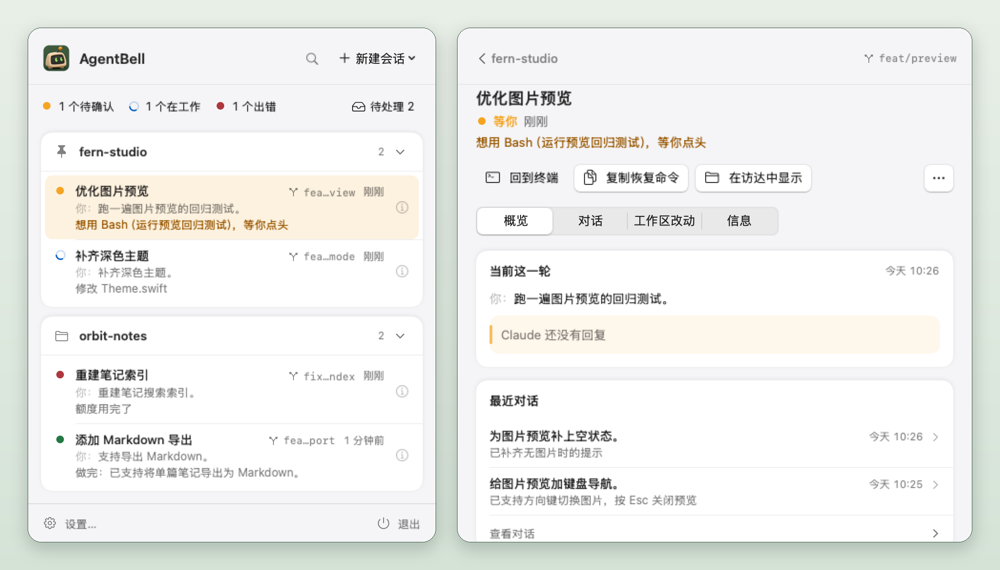
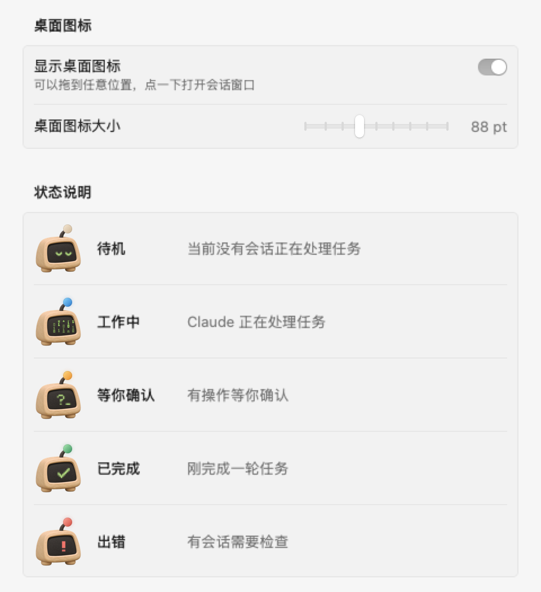

# AgentBell

**几个 Claude Code 会话并行跑，也知道该切回哪一个。**

AgentBell 是一个原生 macOS 小工具。它把散在不同项目、分支和终端里的 Claude Code 会话收进一个面板。需要你确认时亮灯，点一下就回到现场。


## 一眼看状态，一键回现场



*左边是按项目分组的会话列表，右边是选中会话的详情。截图来自应用界面，项目、分支和对话均为虚构。*

| 日常场景 | AgentBell 怎么帮你 |
| --- | --- |
| 同时盯几个项目 | 按项目分组或用侧栏浏览，置顶常用项目。用「待处理」集中看待确认和出错的会话，或按项目名、会话标题、分支搜索。 |
| 找回刚才那轮 | 点会话跳回原终端。打开详情可看最近对话、Git 分支和工作区改动。任务关联的会话关掉后，可在「开发任务」里点「继续工作」，在原工作目录恢复。 |
| 在另一个分支开工 | 从置顶项目、最近项目或任意文件夹新建 Claude Code 会话。有多个 Git worktree 时，可先选工作目录。 |
| 手头正忙 | 用菜单栏或桌面小终端看状态。待确认、出错、长回合完成时可收到系统通知或桌面气泡。长回合阈值可调。 |

Ghostty（1.4+）、iTerm2 和 macOS「终端」支持新建和精确跳回。Ghostty 与 iTerm2 还能定位到分屏。其他终端可切回应用。在「设置 › 通用」打开「跳转后铺满屏幕」，跳回或新建会话时，终端窗口没铺满就铺满当前屏幕（不进入全屏）；需要辅助功能权限。

## 桌面小终端

点小终端打开会话窗口。拖到屏幕左侧或右侧松手，它会贴边收起，鼠标停留时探出。在「设置 → 桌面」可实时调整图标大小（64–128 pt，默认 88 pt），也可从图标的右键菜单直接打开「桌面设置」。



*图为设置页的静态预览。桌面上工作时会滚动 `0` 和 `1`，完成时会短暂显示对勾。*

## 代码审查

在「设置 → 审查」选一次默认仓库，需要时再调整 Review 模板、默认模型和报告的保存位置。之后在侧栏的「代码审查」页点「新建审查」（也可以在「新建会话」菜单里选「新建代码审查…」，或在项目上右键选「新建审查」），粘贴整条团队消息，点「开始审查」（⌘↩）即可。表单里的「仓库」默认是「自动」，会写出匹配到的本地仓库：完整 MR 链接按 origin 匹配已有仓库，`!编号` 和分支名优先使用默认仓库；匹配不到或有多个时，先在这里选一个。模型可选「默认（推荐）」、Fable 和 Opus；「默认」跟 Claude Code 里 `/model` 的默认一致。

AgentBell 会检查审查范围，再让 Claude 在独立 worktree 里后台审查。Claude 能读这份 worktree 里的代码（比如调用方），但不能改文件、跑命令或读 worktree 以外的内容。审查要几分钟，可以关掉窗口，也可以同时发起别的审查。审查结束时，按「设置 › 通知」的开关发系统通知或桌面气泡，点开就是那次审查。

审查窗口左边列出进行中和已完成的审查，右边显示报告。每次审查保存为一个文件夹，里面有 `report.md`，默认放在 `~/Library/Application Support/AgentBell/Review Reports/`，可以在设置里换位置。报告可以复制、在访达中显示、用默认应用打开编辑，也可以删除（支持多选和 ⌫ 键）。想接着追问，点「在终端继续」，会在终端里恢复这次审查的会话。审查用的 worktree 放在 `~/Library/Application Support/AgentBell/Reviews/`，三天后在下次审查同一仓库时清理；清理后报告还在，只是不能再在终端继续。删除审查记录时，它的 worktree 也一起删除。MR 使用已登录的 GitLab CLI（`glab`）读取元数据。

## 周报

在侧栏的「周报」页点「生成周报」，选「本周」或「上周」（按周一到周日算），表单会先读出这段时间有多少会话，并按项目列出；不想写进周报的项目取消勾选即可，下次会保持不勾选。再点「生成周报」（⌘↩）。AgentBell 读取这段时间你在 Claude Code 里每轮的提问和最后的回答，按项目整理后交给所选模型，Claude 不使用任何工具。代码审查、周报这些 AgentBell 自己发起的会话不算在内。

周报模板和默认模型在「设置 › 周报」里改，模板可用 `{{period}}`（本周或上周）、`{{next_period}}`（它的下一周，写计划用）和 `{{days}}`（日期范围）。写好的周报存在 `~/Library/Application Support/AgentBell/Weekly Reports/`，每份一个带 `report.md` 的文件夹。在周报窗口里切到「编辑」可以直接改，边改边保存；也可以复制、在访达中显示或用默认应用打开。想让 Claude 改，点「在终端继续」：会话会恢复，在会话列表里带日历图标，标题是「周报 日期范围」。

## 快速开始

需要 **macOS 14+**、**Xcode 16+（Swift 6）**，以及支持 `claude agents --json` 的 **Claude Code**。

```bash
git clone https://github.com/lance2016/AgentBell.git agent-bell
cd agent-bell
scripts/build-app.sh --install
```

1. 打开 AgentBell，点「连接」启用 Claude Code hooks。现有会话可以继续使用。
2. 需要通知时，点「允许通知」。第一次新建或跳回会话时，按 macOS 提示授权控制终端。
3. 想让跳回的分屏亮起边框，可在「设置 → 权限」里开启辅助功能。

会话看得到却没有提醒时，在「设置 → 通用 → 连接诊断」可核对最近一次会话事件、发送独立的系统测试提醒，或测试跳回终端。

菜单栏图标开关在「设置 → 通用」。面板内常用快捷键为 `⌘F` 搜索、`↩` 回终端、`⌘I` 看详情、`⌘C` 复制恢复命令。在任何地方按 `⌃⌥⌘J` 回到等你最久的会话，`⌃⌥⌘B` 打开面板，可在「设置 → 通用」里改。

## 数据留在本机

AgentBell 在本机读取会话列表、对话记录和 Git 状态，hook 事件通过本机 Unix socket 传递。检查更新时会请求 GitHub 的公开发布信息，点「下载并安装」时才下载新版本。主动发起代码审查时，会通过 GitLab 和 Git 读取所选提交，并交由你配置的 Claude Code 模型审查差异和该提交的代码。

<details>
<summary>安装、连接与卸载细节</summary>

- `scripts/build-app.sh` 将应用打包到 `build/AgentBell.app` 并启动。加 `--install` 安装到 `/Applications`，加 `--no-launch` 跳过启动。
- 构建脚本优先使用钥匙串里的签名证书。使用临时签名时，重新构建后可能需要重新授权终端控制和辅助功能。
- 连接前会备份 `~/.claude/settings.json`，再注册 AgentBell hooks。仅靠轮询也能看到工作和空闲状态。待确认、完成和出错状态由 hooks 提供。
- 卸载时，先在「设置 → 通用」里点「断开」，再退出并删除应用。需要同时清除本地记录时，可删除 `~/Library/Application Support/AgentBell/`。

</details>

<details>
<summary>开发与排查</summary>

```bash
swift test
scripts/build-app.sh
swift scripts/make-icon.swift
```

用打包后的 `.app` 验证通知和 hooks。[架构设计](DESIGN.md) · [界面与交互](UI_DESIGN.md) · [更新记录](CHANGELOG.md) · [版本发布](https://github.com/lance2016/AgentBell/releases)

```bash
/usr/bin/log show --last 10m --style compact --predicate 'subsystem == "com.agentbell.AgentBell"'
```

</details>
